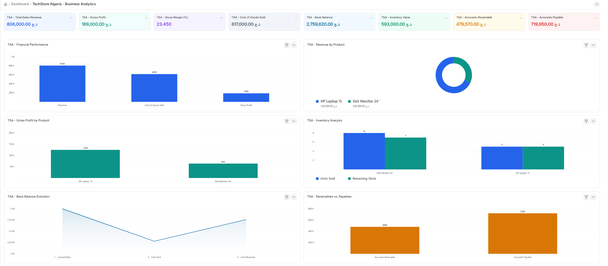

# TechStore Algeria | ERP Business Analytics

## Interactive Dashboard

[Explore the Interactive Dashboard](https://walidbrml.github.io/techstore-erp-analytics/)

## Original ERPNext Dashboard

The original dashboard was developed directly within ERPNext v16 using seven custom SQL reports connected to MariaDB.

## Project Overview

What started as an interest in learning ERPNext became a practical Data Analytics and Business Intelligence project.

TechStore Algeria is a simulated IT retail company designed to explore how transactional ERP data can be transformed into meaningful business insights using SQL and analytical dashboards.

## Project Objectives

- Understand integrated business processes.
- Extract and transform ERP transactional data.
- Develop financial and operational KPIs.
- Analyze sales, profitability and inventory.
- Validate analytical results against accounting records.
- Present business insights through interactive visualizations.

## Key Performance Indicators

| KPI | Value |
|---|---:|
| Sales Revenue | 806,000 DZD |
| Cost of Goods Sold | 617,000 DZD |
| Gross Profit | 189,000 DZD |
| Gross Margin | 23.45% |
| Bank Balance | 2,759,620 DZD |
| Inventory Value | 593,000 DZD |
| Accounts Receivable | 479,570 DZD |
| Accounts Payable | 719,950 DZD |

## Dashboard Features

- 8 financial KPIs
- 6 interactive analytical charts
- 7 custom SQL reports in ERPNext
- Product profitability analysis
- Inventory and sell-through analysis
- Transaction-level bank balance monitoring
- Receivables and payables analysis
- CSV export
- Responsive design
- Light and dark mode

## Business Insights

- Laptops contribute 68.24% of total sales revenue.
- Monitors achieve a higher gross margin of 25%.
- Overall gross margin reaches 23.45%.
- Inventory sell-through rate reaches 52%.
- Supplier payables exceed customer receivables by 240,380 DZD.

## Technical Architecture

ERPNext → MariaDB → SQL Analytics → ERPNext Dashboard → Public Web Dashboard

The public dashboard uses a validated snapshot of the simulated ERPNext data.

## SQL Skills Applied

- INNER JOIN and LEFT JOIN
- Common Table Expressions (CTEs)
- Window Functions
- Conditional Aggregation
- GROUP BY
- CASE WHEN
- UNION ALL
- Data Filtering
- Running Balance Calculations
- Data Validation

## Data Validation

Analytical results were reconciled against:

- General Ledger
- Profit and Loss Statement
- Balance Sheet
- Stock Balance
- Accounts Receivable
- Accounts Payable

## Technology Stack

| Category | Technology |
|---|---|
| ERP | ERPNext v16 |
| Framework | Frappe |
| Database | MariaDB |
| Data Analytics | SQL |
| Visualization | ERPNext Dashboard, Chart.js |
| Web Interface | HTML, CSS, JavaScript |
| Environment | Ubuntu, WSL2 |
| Hosting | GitHub Pages |

## Limitations

This project uses simulated business transactions for educational and portfolio purposes.

The public website is an interactive data snapshot, not a live connection to the local ERPNext database.

## Future Improvements

- Larger transactional datasets
- Dynamic reporting periods
- Advanced inventory analytics
- Power BI integration
- Automated data extraction
- Predictive analytics

## Author

Walid Bouremel

Data Analytics & Business Intelligence

- [LinkedIn](https://www.linkedin.com/in/walid-bouremel/)
- [GitHub](https://github.com/WalidBrml)

---

Independent learning and portfolio project.
